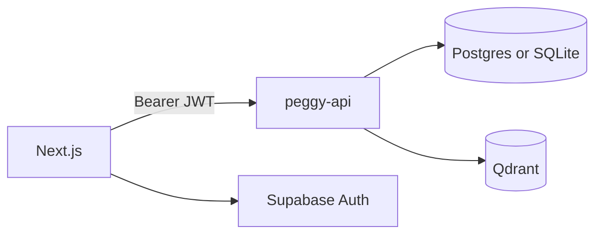

# Peggy Research Assistant — Architecture

**Local first:** [LOCAL.md](LOCAL.md) · **Production:** [SCALE.md](SCALE.md) · **Agent roadmap:** [AGENT.md](AGENT.md)

## Niche

Peggy ingests **peer-reviewed literature** and **your own findings** in separate spaces, then supports grounded Q&A, gap analysis, and comparison — with citations and stated limitations. Methodology and standards: [RESEARCH_PAPERS.md](RESEARCH_PAPERS.md).

## Active codebase

```
apps/web/                 Next.js 14 + MUI → Vercel
services/peggy-api/       FastAPI → Railway / Render / Fly.io
scripts/ + tools/qdrant/  Native Qdrant + API (default local)
docker-compose.yml        Optional containers
legacy/                   Archived — do not import
```

## Two corpora

| UI | Route | `source_type` | Qdrant collection |
|----|-------|---------------|-------------------|
| Literature search | `/validate/literature` | `literature` | `peggy_literature` |
| Our findings (summary) | `/results/findings` | `own_findings` | `peggy_own_findings` |
| Findings | `/results/findings` | `own_findings` | `peggy_own_findings` |
| Sample datasets | `/study-design/samples`, `/analysis-tool` | `sample_datasets` | **Not indexed** (file + catalog only) |

Catalog dedup: same PMID, DOI, or normalized title within a `user_id` + `source_type` → skip insert (`duplicate` response).

## Auth (Milestone 1)

Next.js uses Supabase email magic link. FastAPI verifies JWT `sub` as `user_id` on all protected routes. See [AUTH.md](AUTH.md).



Agent session memory uses catalog tables (`agent_sessions`, `agent_messages`) scoped by `user_id`.

## Qdrant collections

| Collection | Purpose |
|------------|---------|
| `peggy_literature` | PubMed + literature PDFs (payload `source_type=literature`; ethics PDFs may share this collection with `source_type=ethics_documents`) |
| `peggy_own_findings` | Narrative findings, research PDFs, and HTML reports (text extracted) |
| `chat_history_logs` | Reserved for cross-session semantic memory (unused) |

Embeddings: `sentence-transformers` locally (hash on Render). Search uses `query_points` (Qdrant client ≥1.16). All vector ops filter by `user_id`. Chat, agent, compare, and gap search also filter `source_type` to `literature` and `own_findings`. **Sample dataset files are never upserted** into these collections.

Original PDF/CSV/SAV/HTML bytes live in `UPLOAD_DIR` locally or private Supabase Storage bucket `peggy-uploads` when `DATABASE_URL` is set. Object paths: `{project_id}/{paper_id}_{filename}` for literature PDFs; `{project_id}/study_docs/{paper_id}_{filename}` for ethics PDFs and sample datasets. Catalog `papers.storage_key` points at the object. Downloads go through owner-only `GET /corpus/{id}/file`.

## LLM providers

| `LLM_PROVIDER` | Use case |
|----------------|----------|
| `ollama` | Local dev (free) |
| `gemini` | Render deploy — Google AI Studio free tier |

Factory: `core/llm/provider.py` · Health: `GET /health` (`llm_reachable`, `embeddings`).

## API overview

### Ingest

| Endpoint | Purpose |
|----------|---------|
| `POST /ingest/pubmed` | PMID / DOI / search → background job (`ingested` + `skipped` duplicates) |
| `GET /ingest/jobs/{id}` | Poll job status |
| `POST /ingest/upload` | PDF, HTML (text only), or plain text (`source_type` form field) |
| `POST /ingest/findings` | Own-findings narrative JSON |
| `GET /discover/suggestions` | Discovery topic chips (workspace aim, profile, corpus TF-IDF) |
| `POST /discover` | Literature discovery (PubMed + Europe PMC + OpenAlex, read-only) |

### Corpus

| Endpoint | Purpose |
|----------|---------|
| `GET /corpus?source_type=` | List papers (`literature` \| `own_findings` \| `sample_datasets` \| `ethics_documents`) |
| `GET /corpus/{id}/file` | Owner download of stored original bytes (relocates legacy paths to the current layout) |
| `POST /corpus/migrate-files` | Copy existing originals onto `{project_id}/` or `{project_id}/study_docs/` and update `storage_key` |
| `DELETE /corpus?source_type=literature` | Delete all literature for the user (optional `workspace_id`); files + Qdrant |
| `GET/PATCH/DELETE /corpus/{id}` | CRUD including `notes` and `read_at`; Qdrant purge and file delete |

### RAG & workflows

| Endpoint | Purpose |
|----------|---------|
| `POST /agent/run` | Reactive agent (sync) — Auto mode in UI |
| `POST /agent/stream` | Agent SSE (`step_start`, `tool_call`, `tool_result`, `final`) |
| `POST /chat` | Single-shot Ask Peggy — `mode`: chat \| gap_analysis \| compare (auto uses intent routing if called directly) |
| `POST /workflows/gap-analysis` | Structured gaps (optional `workspace_id` saves history) |
| `GET /workflows/gap-analysis/history` | Gap runs for a workspace |
| `DELETE /workflows/gap-analysis/history` | Clear all gap runs for a workspace |
| `GET /workflows/gap-analysis/{id}` | Replay a saved gap run |
| `DELETE /workflows/gap-analysis/{id}` | Delete one saved gap run |
| `POST /ingest/citations` | Queue PubMed ingest from workflow source citations (gap scan papers) |
| `POST /workflows/conference-abstract` | Draft abstract (intro, methods, results, conclusion) with `min_words` |
| `POST /workflows/validate-aim` | Check project aim/objectives against literature |
| `GET /workflows/validate-aim/history` | Validate-aim runs for a workspace |
| `GET /workflows/validate-aim/{id}` | Replay a saved validate-aim run |
| `GET /auth/github/login` | GitHub OAuth authorize URL (Bearer required) |
| `GET /auth/github/callback` | OAuth callback (stores token server-side) |
| `GET /github/repos` | List repos for linked account |
| `GET/POST /workspaces` | List / create projects (`aim`, `objectives[]`) |
| `GET/PATCH/DELETE /workspaces/{id}` | Read / update / delete project |
| `GET/PATCH /workspaces/{id}/study-design` | One `study_design` row per project. Save updates that section’s column (`samples`, `ethics`, `budget`, `methods_plan`, `analysis_plan`, `proposal`, `objective_links`). PDF uploads stay in `papers`; Save stores their ids as `linkedDocuments` on samples or ethics. |
| `GET/POST /calendar/events` | User calendar; optional `workspace_id` filter |
| `PATCH/DELETE /calendar/events/{id}` | Update or delete a calendar event |
| `GET/POST /workspaces/{id}/lab-book` | Project lab book notes |
| `PATCH/DELETE /workspaces/{id}/lab-book/{id}` | Edit or delete a lab book note |
| `GET /workspaces/{id}/papers/summary` | Literature table payload: papers + computed review status from `extractions` |
| `GET /workspaces/{id}/coverage` | Coverage matrix aggregation for dashboard/gap analysis (grouped counts from `extractions`) |
| `GET /extraction-modules` | Versioned field schemas (`core`, `outcomes`, …) from `core/extraction/schemas/` |
| `GET/POST /workspaces/{id}/extractions` | List or bulk upsert structured extractions per paper |
| `PATCH /workspaces/{id}/extractions/{id}` | Review screen: confirm or correct a field (`status`, `value`, quote) |
| `POST /workflows/extract` | Queue background extraction job (2 papers at a time); writes `extractions` rows |
| `GET /workflows/extract/jobs/{id}` | Poll extraction job status and per-paper results |
| `PATCH /workspaces/{id}/github` | Link repo to project |
| `POST /workspaces/{id}/github/sync` | Ingest README + `docs/*.md` as own findings |
| `POST /workflows/study-design/ethics-guidance` | FMHS ethics checklist from samples profile + optional question |
| `POST /workflows/study-design/methods-plan` | Methods review or suggest (`mode`: review \| suggest) |
| `POST /workflows/study-design/analysis-plan` | Analysis review or suggest (`adhoc_tests` plus saved `analysisPlan.adhocAnalyses`) |
| `POST /workflows/study-design/proposal` | 1–2 page proposal from workspace study design + literature |
| `POST /workflows/compare` | Finding vs literature; optional `workspace_id` injects study design + plans; retrieval is literature + own findings only |
| `GET /workspaces/{id}/transfer-pack` | ZIP: export JSON + original files + chunk texts (no vectors) |
| `POST /workspaces/import-pack` | Import ZIP as a new project for the signed-in user |
| `POST /workflows/future-design` | Study design draft (API only) |
| `POST /workflows/manuscript-framing` | Discussion draft (API only) |
| `POST /feedback` | Correction queue (API only) |
| `GET /health` | Qdrant, LLM, embeddings status |
| `GET /setup/checks` | Deterministic setup checks for the Setup screen (includes fix commands) |

Workflow and chat responses include `sources[]`, `confidence`, `limitations`. Chat/workflow gap/compare also return structured `body`.

### Chat request example

```json
{
  "query": "Compare our butyrate finding to the literature",
  "mode": "auto",
  "source_types": ["literature", "own_findings"]
}
```

## Web routes

| Route | Nav | Purpose |
|-------|-----|---------|
| `/` | 01 Home | `PeggyWelcomeHub` (unchanged) then stats (projects / literature papers / unread), project cards with paper counts, recent activity derived from ingest/open/read timestamps (no activity table), reading reminder → journal |
| `/projects` | 02 Project hub | Dedicated project list and **+ New project** |
| `/calendar` | 03 Calendar | Month/list events; optional project filter; add from aims, objectives, plan steps, ethics expiry; weekly/monthly/yearly repeat (one stored series, expanded on list) |
| `/reading-journal` | 04 Reading journal | Literature only; To read / Completed (`read_at`); search, project filter, paper cards with project title and PMID; Preview PDF; delete one paper or all literature; migrate stored files on load |
| `/ask` | 05 Ask Peggy | Research assistant chat; project + sources (literature / own findings / both); suggested questions fill the composer; Auto/Ask. Same layout as in-project Ask Peggy. |
| `/useful-links` | 06 Useful links | Curated external resources by category |
| `/help` | Help (sidebar footer) | Platform tips: navigation, validate, design, Ask Peggy |
| `/setup` | — | Redirects to `/setup/checks` |
| `/setup/checks` | — | Setup check (`GET /setup/checks`): status card, check list, copyable fix commands |
| `/setup/step-*` | — | New-project wizard (uses HomeAppShell) |
| `/dashboard` | 01 Dashboard | Per-objective progress (manual done toggle, linked artifacts) + project setup roadmap; **Export project JSON**, **Download transfer pack**, **Import transfer pack** |
| `/validate` | 02 Validate | Section hub (when to use each step); tab bar on sub-pages |
| `/validate/gap-analysis` | 02 · Gap analysis | Quick scan, evidence coverage matrix, open gaps (Figma-aligned) |
| `/validate/literature` | 02 · Literature search | Table + inline extraction panel; `?paperId=` / `?q=` |
| `/validate/aim` | 02 · Aim and objectives | Multiple aims (overall required + Aim 1…); objectives each linked to one aim; **Save aims** / **Save objectives**; literature check |
| `/study-design` | 03 Study Design | Section hub; tab bar on sub-pages |
| `/study-design/samples` | 03 · Samples | Cohort profile (recruitment, inclusion/exclusion) + optional PDF/CSV/TSV/SAV upload (`sample_datasets`; confirm at own risk). **Preview** shows the data table (same parse as the Analysis tool). Edit/Delete on each row. |
| `/study-design/ethics` | 03 · Ethics | Approval summary (committee/status/letter), optional question, cohort checklist, documents table (`ethics_documents`) |
| `/study-design/budget` | 03 · Budget | Grid-style line-item budget (category, amount, notes) |
| `/study-design/methods-plan` | 03 · Methods plan | From your project, your plan, result, steps, similar-studies checklist, Completed |
| `/study-design/analysis-plan` | 03 · Analysis plan | From your project, your plan, result, steps, similar-studies checklist, Completed. Sensitivity/ad hoc tests live under Advanced options and are sent to the review/suggest LLM. Results render structured fields or `full_text` / leftover JSON keys (including `{raw}` fallback). |
| `/study-design/proposal` | 03 · Proposal | 1–2 page draft; export saved result as `.md` or `.docx` |
| `/analysis-tool` | 04 Analysis tool | 01 Dataset (CSV/TSV/SAV upload on this page). 02 Dataset overview: admin columns, paginated table, types, descriptives. Categorical summaries list category counts and %. 03 Analysis guidance: pick participant columns, groups/design, suggested test, **Run on this dataset**. Save stores headers/rows in `study_design.analysisTool`. SAV via `POST /api/parse-sav`. |
| `/results` | 05 Results | Section hub; tab bar on sub-pages |
| `/results/methods` | 05 · Methods | Placeholder |
| `/results/findings` | 05 · Our findings | Summary of uploaded findings so far (`GET/POST /workflows/findings-summary`) |
| `/results/findings` | 05 · Findings | Summary, upload (narrative/PDF/HTML), objective tags; `/results/report` redirects here |
| `/results/comparison` | 05 · Comparison | Finding vs ingested literature; optional live PubMed/OpenAlex/Europe PMC abstracts (`include_live`) |
| `/outputs` | 06 · Outputs | Figures: Start from results is enabled only when `own_findings` exist. Tables persist in `study_design.outputs.tables`. Abstract versions persist in `study_design.outputs.abstractDrafts` (nested in proposal JSON). Generate/import disabled until findings are uploaded. |
| `/lab-book` | 07 Lab book | Project notes (progress, meeting, idea, methods, other) |
| `/chat` | 08 · Ask Peggy (project sidebar) | Same Ask Peggy layout as `/ask`, with project locked; Gaps/Compare, import from project, and Add to Methods stay available |
| `/login` | — | Supabase email magic link |

Legacy redirects: `/ingest` → literature search, `/gaps` → gap analysis, `/study-design/gap-analysis` → gap analysis, `/findings` → our findings, `/compare` → comparison.

### Project objectives (data model)

| Location | Shape | Notes |
|----------|-------|-------|
| `workspaces.objectives` | `{ id, text, status: "draft" \| "defined" \| "revised" \| "dropped" }[]` | Legacy `string[]` and `status: open|done` are normalized on read/write (open→draft, done→defined). Empty draft rows are kept in the editor so **Add objective** can show a blank field; Save still drops blank text. |
| `methodsPlan.steps` / `analysisPlan.steps` | `{ id, title, objectiveIds[] }[]` | `objectiveIds` may include `"aim"` |
| `study_design.objective_links` | `{ findingLinks: { paperId, objectiveIds[] }[] }` | Tags on `own_findings` papers; orphans pruned on delete |
| `objective_history` | `{ workspace_id, objective_id, old_text, new_text, old_status, new_status, reason, actor, created_at }[]` | Append-only audit trail when objectives change |

Migration: `009_objective_links.sql` adds the `objective_links` column. See [DATABASE.md](DATABASE.md).

### Web UI layout

- **Dashboard** — `buildObjectiveProgress()` shows each objective with manual done status, counts of linked methods/analysis steps and findings, and links to the relevant screens. `buildProjectProgress()` drives the project setup roadmap (next step, possible next steps, full timeline). Sidebar nav remains the primary way to open Validate, Study Design, Results, and Ask Peggy.
- **Objective linking** — Workspace `objectives` are `{ id, text, status }[]` (legacy `string[]` migrated on read). Methods and analysis plans store optional `steps[]` with `objectiveIds` (including `"aim"`). Finding sets store tags in `study_design.objective_links.findingLinks` as `{ paperId, objectiveIds[] }`. When objective text changes, linked steps and finding links receive derived flags (`objectiveChanged`, `objectiveChangedObjectiveIds`) to surface “Objective changed” in the UI.
- **Help** — `/help` (linked above Log out in the sidebar) summarizes navigation and core workflows. Sidebar nav links show hover tooltips where useful.
- **Section tabs** — Study Design and Results use `SectionGroupLayout` (section eyebrow + `SectionSubNav` tabs). Sidebar child links for those groups stay collapsed on sub-routes so tabs are the primary wayfinding.
- **Page surfaces** — Inner routes use `PageSection` (single bordered panel) and `PageHeader` with `compact` under section layouts; top-level pages (Dashboard, Corpus, Chat) keep full headers.
- **Data safety** — `DataSafetyBanner` on Samples & datasets only (de-identified cohort text and optional uploads).
- **Study design save** — each section has a Save button. It stays disabled when that section matches the stored row. Edits stay in the form until Save. Uploaded PDFs are linked on Save and do not replace typed fields.

Protected routes require Supabase session (middleware). All API routes except `/health` require Bearer JWT when `AUTH_REQUIRED=true`.

## Deployment

| Layer | Milestone 1 | Milestone 2 |
|-------|-------------|-------------|
| Frontend | Vercel (auth shell) + localhost full app | Vercel + public API |
| API | localhost `:8000` | Railway / Render / Fly |
| Vectors | Local Qdrant | Qdrant Cloud |
| Catalog + auth | Supabase — [DATABASE.md](DATABASE.md), [AUTH.md](AUTH.md) |
| Original files | Local `UPLOAD_DIR` | Supabase Storage `peggy-uploads` |
| Jobs | Inngest (optional) | Inngest (optional) |
| Cache | Upstash Redis (optional) | Upstash Redis (optional) |

## Own-findings payload

```json
{
  "title": "Cohort alpha diversity summary",
  "cohort": "NPD",
  "findings": [],
  "narrative": "Free-text summary for embedding."
}
```

## Local development

Native (default): [LOCAL.md](LOCAL.md). Optional: [DOCKER.md](DOCKER.md).

- API: http://localhost:8000/docs (local only; disabled on Render when `AUTH_REQUIRED`)  
- Web: http://localhost:3000  
- Smoke: `./scripts/smoke-local.sh`

## Legacy

`legacy/steve/`, `legacy/peggy_bot/`, `legacy/kwacha_bot/` — reference only. **Do not import in active code.**
