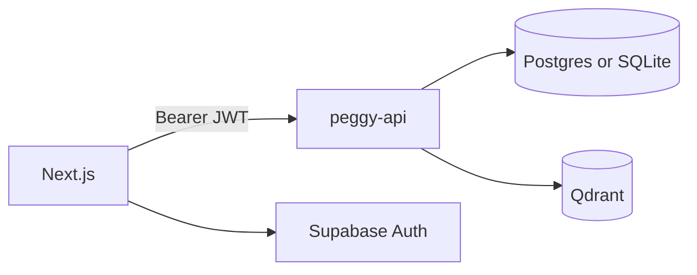

# Peggy Research Assistant — Architecture

**Local first:** [LOCAL.md](LOCAL.md) · **Production:** [SCALE.md](SCALE.md) · **Agent roadmap:** [AGENT.md](AGENT.md)

## Niche

Peggy ingests **literature** (labelled peer-reviewed only when `classify_peer_review` says so) and **your own findings** in separate spaces, then supports grounded Q&A, gap analysis, and comparison — with citations and stated limitations. Methodology and standards: [REFERENCES.md](REFERENCES.md). Retracted papers are excluded from retrieval.

## UI copy

Product strings are short and professional. Checkboxes name the action. Alerts are one sentence. Help states facts, not tours. Rule: [`.cursor/rules/ui-copy.mdc`](../.cursor/rules/ui-copy.mdc).

## Active codebase

```
apps/web/                 Next.js 15 + MUI → Vercel
services/peggy-api/       FastAPI → Render
scripts/ + tools/qdrant/  Native Qdrant + API (default local)
docker-compose.yml        Optional containers
```

## Two corpora

| UI | Route | `source_type` | Qdrant collection |
|----|-------|---------------|-------------------|
| Literature search | `/validate/literature` | `literature` | `peggy_literature` |
| Findings | `/results/findings` | `own_findings` | `peggy_own_findings` |
| Sample datasets | `/study-design/samples` | `sample_datasets` | **Not indexed** (file + catalog only) |
| Ethics letters | `/study-design/ethics` | `ethics_documents` | Same collection as literature, payload `source_type=ethics_documents`; excluded from LLM search |

Catalog dedup: same PMID, DOI, or normalized title within a `user_id` + `source_type` → skip insert (`duplicate` response).

## Auth (Milestone 1)

Next.js uses Supabase email magic link. FastAPI verifies JWT `sub` as `user_id` on all protected routes. See [AUTH.md](AUTH.md).



Agent session memory uses catalog tables (`agent_sessions`, `agent_messages`) scoped by `user_id`.

## Qdrant collections

| Collection | Purpose |
|------------|---------|
| `peggy_literature` | PubMed + literature PDFs (payload `source_type=literature`; ethics PDFs may share this collection with `source_type=ethics_documents`) |
| `peggy_own_findings` | Narrative findings, research PDFs, and HTML reports (text extracted) |
| `chat_history_logs` | Reserved for cross-session semantic memory (unused) |

Embeddings: `sentence-transformers` or hash locally; hosted Gemini (`EMBEDDING_BACKEND=gemini`, `text-embedding-004`, 768-d) uses **versioned** Qdrant collection names (`peggy_literature__text_embedding_004_768`). Hash on Render is the env default and is **not** semantic. Search uses `query_points` (Qdrant client ≥1.16). All vector ops filter by `user_id` and `workspace_id`. Chat, agent, compare, and gap search also filter `source_type` to `literature` and `own_findings`, omit retracted points, and honor workspace `settings.peer_reviewed_only` (default true). **Sample dataset files are never upserted** into these collections. Project-text embed/LLM calls go through `core/safety/policy.py`.

Original PDF/CSV/SAV/HTML bytes live in `UPLOAD_DIR` locally. On hosted (`DATABASE_URL` set), upload **requires** `SUPABASE_URL` + `SUPABASE_SERVICE_ROLE_KEY` and writes private bucket `peggy-uploads` (`sb:` keys). Preview on disk is cache only; `GET /corpus/{id}/file` reads Storage if the Render disk is empty, including older `local:` keys. Object paths: `{project_id}/{filename}` for literature PDFs; `{project_id}/study_docs/{filename}` for ethics PDFs and sample datasets. `GET /health` `storage` is false when hosted credentials are missing.

## LLM providers

| `LLM_PROVIDER` | Use case |
|----------------|----------|
| `ollama` | Local dev (free) |
| `gemini` | Render deploy — Google AI Studio free tier |

Factory: `core/llm/provider.py` · Health: `GET /health` (`llm_reachable`, `embeddings`). Gemini retries high-demand responses on fallback Flash models. Empty PDF text on upload can call Gemini multimodal extract. Methods Plan and Proposal UI render markdown via `FormattedText` (no raw `*` dump).

## API overview

### Ingest

| Endpoint | Purpose |
|----------|---------|
| `POST /ingest/pubmed` | PMID / DOI / search → background job (`ingested` + `skipped` duplicates) |
| `GET /ingest/jobs/{id}` | Poll job status |
| `POST /ingest/upload` | PDF, HTML (text only), or plain text (`source_type` form field) |
| `POST /ingest/findings` | Own-findings narrative JSON |
| `GET /discover/suggestions` | Discovery topic chips (workspace aim, profile, corpus TF-IDF) |
| `POST /discover` | Literature discovery (PubMed + Europe PMC + OpenAlex, read-only) |

### Corpus

| Endpoint | Purpose |
|----------|---------|
| `GET /corpus?source_type=` | List papers (`literature` \| `own_findings` \| `sample_datasets` \| `ethics_documents`) |
| `GET /corpus/{id}/file` | Owner download of stored original bytes (relocates legacy paths to the current layout) |
| `POST /corpus/migrate-files` | Copy existing originals onto `{project_id}/` or `{project_id}/study_docs/` and update `storage_key` |
| `DELETE /corpus?source_type=literature` | Delete all literature for the user (optional `workspace_id`); files + Qdrant |
| `GET/PATCH/DELETE /corpus/{id}` | CRUD including `notes` and `read_at`; Qdrant purge and file delete |

### RAG & workflows

| Endpoint | Purpose |
|----------|---------|
| `POST /agent/run` | Reactive agent (sync) — Auto mode in UI |
| `POST /agent/stream` | Agent SSE (`step_start`, `tool_call`, `tool_result`, `final`) |
| `POST /chat` | Single-shot Ask Peggy — `mode`: chat \| gap_analysis \| compare (auto uses intent routing if called directly) |
| `POST /workflows/gap-analysis` | Structured gaps (optional `workspace_id` saves history) |
| `GET /workflows/gap-analysis/history` | Gap runs for a workspace |
| `DELETE /workflows/gap-analysis/history` | Clear all gap runs for a workspace |
| `GET /workflows/gap-analysis/{id}` | Replay a saved gap run |
| `DELETE /workflows/gap-analysis/{id}` | Delete one saved gap run |
| `POST /ingest/citations` | Queue PubMed ingest from workflow source citations (gap scan papers) |
| `POST /workflows/conference-abstract` | Draft abstract (intro, methods, results, conclusion) with `min_words` |
| `POST /workflows/validate-aim` | Check project aim/objectives against literature |
| `GET /workflows/validate-aim/history` | Validate-aim runs for a workspace |
| `GET /workflows/validate-aim/{id}` | Replay a saved validate-aim run |
| `GET /auth/github/login` | GitHub OAuth authorize URL (Bearer required) |
| `GET /auth/github/callback` | OAuth callback (stores token server-side) |
| `GET /github/repos` | List repos for linked account |
| `GET/POST /workspaces` | List / create projects (`aim`, `objectives[]`) |
| `GET/PATCH/DELETE /workspaces/{id}` | Read / update / purge project (files + Qdrant + catalog) |
| `GET /account/export` | Zip of all projects (rate-limited; `include_files=false` optional) |
| `DELETE /account` | Purge all projects then delete the auth user |
| `GET/PATCH /workspaces/{id}/study-design` | One `study_design` row per project. Save updates that section’s column (`samples`, `ethics`, `budget`, `methods_plan`, `analysis_plan`, `proposal`, `objective_links`). Saving ethics expiry upserts a calendar event. PDF uploads stay in `papers`; Save stores their ids as `linkedDocuments` on samples or ethics. |
| `GET/PUT /workspaces/{id}/project-admin` | One `project_admin` row per workspace (registration, dates, grants, outputs, MOU, registration PDF, co-investigator, optional data-transfer, funding PDFs). Files are `project_documents`. Dated fields upsert calendar events. |
| `GET/POST /calendar/events` | User calendar; optional `workspace_id` filter |
| `PATCH/DELETE /calendar/events/{id}` | Update or delete a calendar event |
| `GET/POST /workspaces/{id}/lab-book` | Project lab book notes |
| `POST /workspaces/{id}/lab-book/image` | Lab book note with image |
| `GET /workspaces/{id}/lab-book/{id}/file` | Stored lab book image |
| `PATCH/DELETE /workspaces/{id}/lab-book/{id}` | Edit or delete a lab book note |
| `GET /workspaces/{id}/papers/summary` | Literature table payload: papers + computed review status from `extractions` |
| `GET /workspaces/{id}/coverage` | Coverage matrix aggregation for dashboard/gap analysis (grouped counts from `extractions`) |
| `GET /extraction-modules` | Versioned field schemas (`core`, `outcomes`, …) from `core/extraction/schemas/` |
| `GET/POST /workspaces/{id}/extractions` | List or bulk upsert structured extractions per paper |
| `PATCH /workspaces/{id}/extractions/{id}` | Review screen: confirm or correct a field (`status`, `value`, quote) |
| `POST /workflows/extract` | Queue background extraction job (2 papers at a time); writes `extractions` rows. Paper text comes from Qdrant, then the stored original file if vectors are empty. Job results include per-paper `reason` when skipped (no text, AI off, LLM error). |
| `GET /corpus/{id}/file` | Original upload bytes (`inline` for PDF preview). `POST /corpus/migrate-files` copies legacy paths to canonical `sb:{workspace_id}/…` on hosted. |
| `GET /workflows/extract/jobs/{id}` | Poll extraction job status and per-paper results |
| `PATCH /workspaces/{id}/github` | Link repo to project |
| `POST /workspaces/{id}/github/sync` | Ingest README + `docs/*.md` as own findings |
| `POST /workflows/study-design/ethics-guidance` | FMHS ethics checklist from samples profile + optional question |
| `POST /workflows/study-design/methods-plan` | Methods review or suggest (`mode`: review \| suggest). Flagged SOP / required-method papers are prepended to the prompt. |
| `POST /workflows/study-design/analysis-plan` | Analysis review or suggest (`adhoc_tests` plus saved `analysisPlan.adhocAnalyses`). Same SOP prepend as methods. |
| `POST /workflows/seed-from-document` | LLM preview of title, aim, objectives, samples, plans, dates from a corpus `paper_id` (class B, PHI guard) |
| `POST /workflows/apply-document-seed` | Apply preview into empty workspace, `study_design`, and `project_admin` fields (`overwrite` optional) |
| `POST /workflows/study-design/proposal` | 1–2 page proposal from workspace study design + literature |
| `POST /workflows/compare` | Finding vs literature; optional `workspace_id` injects study design + plans; retrieval is literature + own findings only |
| `GET /workspaces/{id}/transfer-pack` | ZIP: export JSON + original files + chunk texts (no vectors) |
| `POST /workspaces/import-pack` | Import ZIP as a new project for the signed-in user |
| `POST /workflows/future-design` | Study design draft (API only) |
| `POST /workflows/manuscript-framing` | Discussion draft (API only) |
| `POST /feedback` | Correction queue (API only) |
| `GET /health` | Qdrant, LLM, embeddings, Gemini tier, database, storage |
| `GET/PUT /profile/llm-settings` | Per-user provider, key last-4, daily cap. PUT may set `api_key` (write-only). GET never returns the secret. |
| `GET /setup/checks` | Hosted status; local fix commands only when `AUTH_REQUIRED=false` |
| `POST /workflows/setup-suggestions` | Suggest data type, outcome, aim, country, setting type, population from step 1 plus optional `idea_description` (class B). Stored on `workspaces.settings.project_idea`. |
| `POST /workflows/validate-dataset` | Dataset readiness review from column names and aggregate stats only (class D). Used on `/validate/datasets`. |
| `POST /workflows/idea-from-resources` | 3–5 questions from project resources (class B) |
| `GET /workspaces/{id}/confounder-audit` | Covariates from extractions (`items`) plus coefficient names from imported class D results (`importedCovariates`) |
| `POST /jobs/retraction-recheck` | Weekly job token; OpenAlex/PubMed recheck |
| `POST /jobs/reembed` | New collection; progress counts; no in-place overwrite |
| `POST /workflows/dataset-summary` | Class D aggregates; blocked on unpaid Gemini and strict |
| `GET /agent/proposals` | Pending propose-not-write cards |
| `POST /agent/proposals/{id}/accept` | Writes via existing workspace/study_design PATCH |

Workflow and chat responses include `sources[]`, `confidence`, `limitations`. Chat/workflow gap/compare also return structured `body`.

### Chat request example

```json
{
  "query": "Compare our butyrate finding to the literature",
  "mode": "auto",
  "source_types": ["literature", "own_findings"]
}
```

## Web routes

| Route | Nav | Purpose |
|-------|-----|---------|
| `/` | 01 Home | `PeggyWelcomeHub` (unchanged) then stats (projects / literature papers / unread), project cards with paper counts, recent activity derived from ingest/open/read timestamps (no activity table), reading reminder → journal |
| `/projects` | 02 Project hub | Dedicated project list and **+ New project** |
| `/projects/new` | — | Same wizard from Home and Project hub. Step 1: name, type, field, starting point (creates a draft project). Step 2: idea generates field suggestions; gap scans literature (abstracts) then shows topics; proposal upload + seed preview for review. Step 3: AI privacy (saved onto the draft). `/setup/step-*` redirects here. |
| `/calendar` | 03 Calendar | Month/list events; optional project filter; Add event; weekly/monthly/yearly repeat (one stored series, expanded on list). Ethics renewal and project-admin dates arrive from those screens. |
| `/reading-journal` | 04 Reading journal | Literature only; To read / Completed (`read_at`); search, project filter, paper cards with project title and PMID; Preview PDF; delete one paper or all literature; migrate stored files on load |
| `/ask` | 05 Ask Peggy | Research assistant chat; project + sources (literature / own findings / both); suggested questions fill the composer; Auto/Ask. Same layout as in-project Ask Peggy. |
| `/useful-links` | 06 Useful links | Curated external resources by category |
| `/help` | Help (sidebar footer) | Platform tips: navigation, validate, design, Ask Peggy |
| `/setup` | — | Redirects to `/setup/checks` |
| `/setup/checks` | — | Setup check (`GET /setup/checks`): status card, check list, copyable fix commands |
| `/setup/step-*` | — | Redirects to `/projects/new` |
| `/dashboard` | 01 Dashboard | Project flow chips match stored work: idea/aim text, samples+methods for Design, ethics JSON **or** `ethics_documents` papers, Results from `own_findings`. Next step is the first incomplete chip (not a stale objective-changed flag). **Export project JSON**, **Download transfer pack**, **Import transfer pack**. Evidence coverage counts literature by study-design and exposure keywords. |
| `/project-admin` | 02 Project admin | Owner fields: student registration, start/end, grants, outputs; MOU PDF upload/view (`project_documents`). Dated fields write `user_calendar_events`. Not a Study Design tab. |
| `/validate` | 03 Validate | Section hub (when to use each step); tab bar on sub-pages |
| `/validate/gap-analysis` | 02 · Gap analysis | Quick scan, evidence coverage matrix, open gaps (Figma-aligned) |
| `/validate/literature` | 02 · Literature search | Table + inline extraction panel; `?paperId=` / `?q=` |
| `/validate/datasets` | · Validate datasets | Upload `sample_datasets` (shared with Samples). Optional `settings.dataset_validation_not_required`. Format/readiness check. |
| `/validate/aim` | 02 · Aim and objectives | Multiple aims (overall required + Aim 1…); objectives each linked to one aim; **Save aims** / **Save objectives**; literature check |
| `/study-design` | 04 Study Design | Section hub; tab bar on sub-pages |
| `/study-design/samples` | 04 · Samples | Cohort profile (study type, data types, setting, population, recruitment, inclusion/exclusion, age range) + optional PDF/CSV/TSV/SAV upload (`sample_datasets`; confirm at own risk). **Preview** shows the data table (same parse as the Analysis tool). Edit/Delete on each row. |
| `/study-design/ethics` | 04 · Ethics | Open at any time (not gated on samples or methods). Approval summary (committee/status/letter), optional question, cohort checklist, documents table (`ethics_documents`). Saving an expiry date upserts an `ethics_renewal` calendar event. |
| `/study-design/budget` | 04 · Budget | Grid-style line-item budget (category, amount, notes) |
| `/study-design/methods-plan` | 04 · Methods plan | Four steps: From your project → Methods → Analysis → Review (output, steps, checklist). Review also lists limitations, improvements, and supporting literature. `/study-design/analysis-plan` redirects here. Combined review runs when at least one plan has text. |
| `/study-design/proposal` | 04 · Proposal | 1–2 page draft; export saved result as `.md` or `.docx` |
| `/analysis-tool` | 05 Analysis tool | Tabs: Function, Dataset, Tests, Scripts, Route. Registry (descriptives, OLS, microbiome, SNP, ML review, diet, exposome, omics). Evidence-led route (peer-reviewed vs feasibility, never one score). Import class D JSON. Run records. Compute profile. Reads/genotypes refused. |
| `/results` | 06 Results | Section hub; tab bar on sub-pages |
| `/results/methods` | 06 · Methods | Placeholder |
| `/results/findings` | 06 · Findings | Summary, upload (narrative/PDF/HTML), objective tags; `/results/report` redirects here |
| `/results/comparison` | 06 · Comparison | Finding vs ingested literature; optional live PubMed/OpenAlex/Europe PMC abstracts (`include_live`) |
| `/outputs` | 07 · Outputs | Figures: Start from results is enabled only when `own_findings` exist. Tables persist in `study_design.outputs.tables`. Abstract versions persist in `study_design.outputs.abstractDrafts` (nested in proposal JSON). Generate/import disabled until findings are uploaded. Conference abstract JSON is coerced to `full_text` so the draft panel always has text to show. |
| `/lab-book` | 08 Lab book | Project notes (progress, meeting, idea, methods, other) plus JPEG/PNG/WebP/GIF |
| `/chat` | 09 · Ask Peggy (project sidebar) | Same Ask Peggy layout as `/ask`, with project locked; Gaps/Compare, import from project, and Add to Methods stay available |
| `/login` | — | Supabase email magic link |

Legacy redirects: `/ingest` → literature search, `/gaps` → gap analysis, `/study-design/gap-analysis` → gap analysis, `/findings` → our findings, `/compare` → comparison.

### Project objectives (data model)

| Location | Shape | Notes |
|----------|-------|-------|
| `workspaces.objectives` | `{ id, text, status: "draft" \| "defined" \| "revised" \| "dropped" }[]` | Legacy `string[]` and `status: open|done` are normalized on read/write (open→draft, done→defined). Empty draft rows are kept in the editor so **Add objective** can show a blank field; Save still drops blank text. |
| `methodsPlan.steps` / `analysisPlan.steps` | `{ id, title, objectiveIds[] }[]` | `objectiveIds` may include `"aim"` |
| `study_design.objective_links` | `{ findingLinks: { paperId, objectiveIds[] }[] }` | Tags on `own_findings` papers; orphans pruned on delete |
| `objective_history` | `{ workspace_id, objective_id, old_text, new_text, old_status, new_status, reason, actor, created_at }[]` | Append-only audit trail when objectives change |

Migration: `009_objective_links.sql` adds the `objective_links` column. See [DATABASE.md](DATABASE.md).

### Web UI layout

- **Dashboard** — `buildObjectiveProgress()` shows each objective with manual done status, counts of linked methods/analysis steps and findings, and links to the relevant screens. `buildProjectProgress()` drives the project setup roadmap (next step, possible next steps, full timeline). Sidebar nav remains the primary way to open Validate, Study Design, Results, and Ask Peggy.
- **Objective linking** — Workspace `objectives` are `{ id, text, status }[]` (legacy `string[]` migrated on read). Methods and analysis plans store optional `steps[]` with `objectiveIds` (including `"aim"`). Finding sets store tags in `study_design.objective_links.findingLinks` as `{ paperId, objectiveIds[] }`. When objective text changes, linked steps and finding links receive derived flags (`objectiveChanged`, `objectiveChangedObjectiveIds`) to surface “Objective changed” in the UI.
- **Help** — `/help` (linked above Log out in the sidebar) summarizes navigation and core workflows. Sidebar nav links show hover tooltips where useful.
- **Profile menu** — name at the bottom of the sidebar: Update profile, Settings (`/setup/checks`), **Peggy AI settings** (project Strict/Standard, provider + optional own API key, daily cap, training opt-out, optional TOTP). Switch project and Help sit below the menu. `WorkspaceProvider` wraps HomeAppShell and AppShell so that dialog works on setup and home, not only inside a project.
- **Section tabs** — Study Design and Results use `SectionGroupLayout` (section eyebrow + `SectionSubNav` tabs). Sidebar child links for those groups stay collapsed on sub-routes so tabs are the primary wayfinding.
- **Page surfaces** — Inner routes use `PageSection` (single bordered panel) and `PageHeader` with `compact` under section layouts; top-level pages (Dashboard, Corpus, Chat) keep full headers.
- **Data safety** — `DataSafetyBanner` on Samples & datasets only (de-identified cohort text and optional uploads).
- **Study design save** — each section has a Save button. It stays disabled when that section matches the stored row. Edits stay in the form until Save. Uploaded PDFs are linked on Save and do not replace typed fields.
- **Methods + analysis review** — Review on either planner sends both pasted plans (plus steps) as one protocol. Gaps already covered in the other plan should not be listed. The same `lastResult` is stored on both sections.
- **Analysis tool last results** — `analysisTool` may include `lastRunSummary`, `lastRegression`, and aggregates. Rows stay in IndexedDB and are cleared when the project is deleted in the browser. Functions live in `apps/web/lib/analysis/functions/` (copies under `config/analysis/`).

Protected routes require Supabase session (middleware). All API routes except `/health` require Bearer JWT when `AUTH_REQUIRED=true`.

## Deployment

| Layer | Milestone 1 | Milestone 2 |
|-------|-------------|-------------|
| Frontend | Vercel (auth shell) + localhost full app | Vercel + public API |
| API | localhost `:8000` | Render |
| Vectors | Local Qdrant | Qdrant Cloud |
| Catalog + auth | Supabase — [DATABASE.md](DATABASE.md), [AUTH.md](AUTH.md) |
| Original files | Local `UPLOAD_DIR` | Supabase Storage `peggy-uploads` |
| Jobs | FastAPI BackgroundTasks | FastAPI BackgroundTasks |
| Cache | Upstash Redis (optional) | Upstash Redis (optional) |

## Own-findings payload

```json
{
  "title": "Cohort alpha diversity summary",
  "cohort": "NPD",
  "findings": [],
  "narrative": "Free-text summary for embedding."
}
```

## Local development

Native (default): [LOCAL.md](LOCAL.md). Optional: [DOCKER.md](DOCKER.md).

- API: http://localhost:8000/docs (local only; disabled on Render when `AUTH_REQUIRED`)  
- Web: http://localhost:3000  
- Smoke: `./scripts/smoke-local.sh`

