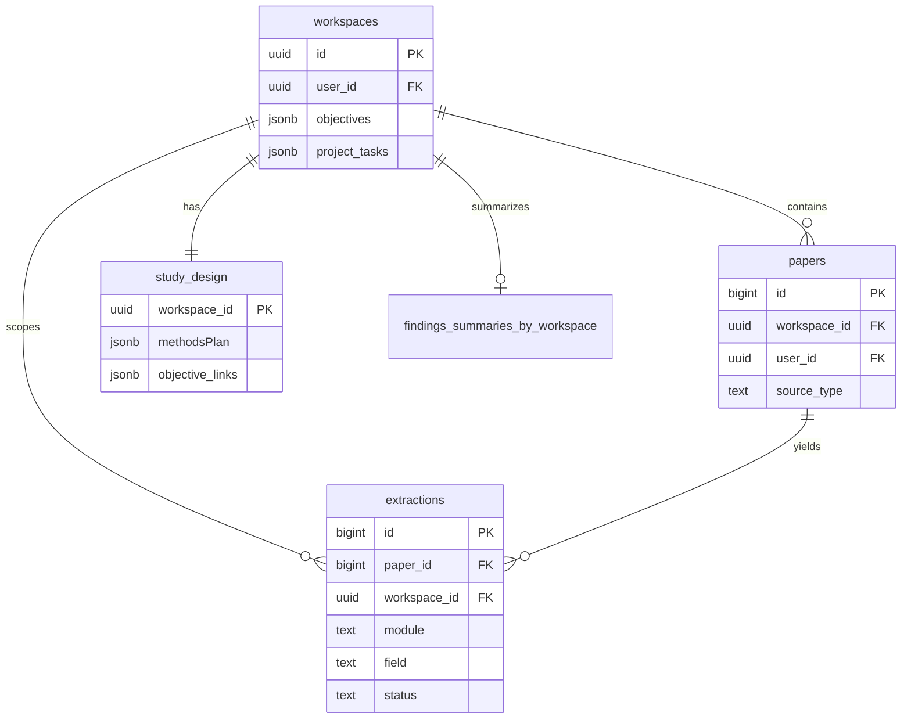

# Database & backend provider

## Current state

| Store | Local dev / tests | With `DATABASE_URL` set |
|-------|-------------------|-------------------------|
| **Vectors** | Local Qdrant or **Qdrant Cloud** | Qdrant Cloud on Render |
| **Catalog** | SQLite via `sqlite_catalog.py` | Postgres via `pg_catalog.py` (Supabase) |
| **Auth** | `AUTH_REQUIRED=false` → `dev-user` | Supabase JWT → real `user_id` |
| **Dedup** | Per `user_id` + `source_type` | Same + partial unique indexes in Postgres |

Facade: `core/store/catalog.py` delegates to SQLite or Postgres based on **`DATABASE_URL`**. When set, `SQLITE_DB` is ignored.

## Supabase project (env only — not in repo)

| Setting | Value |
|---------|--------|
| Project ref | `lmaugorqwhdnotpcqnnf` |
| Region | `eu-west-1` |
| URL | `https://lmaugorqwhdnotpcqnnf.supabase.co` |

## Connection string (`DATABASE_URL`)

1. Supabase Dashboard → **Settings** → **Database**
2. **Connection string** → **URI** → **Transaction pooler** (port **6543**)
3. Replace password with your database password (not anon key, not JWT secret)

Set on `services/peggy-api/.env` (local) and Render Environment. Details: [ENV.md](ENV.md).

Use the **transaction pooler** URI (port **6543**), not the direct session connection. The API sets `statement_cache_size=0` on asyncpg so prepared statements work through PgBouncer.

## Migration

Run `services/peggy-api/migrations/001_supabase_initial.sql` in the Supabase SQL editor, then later migrations in order through `015_papers_journal.sql`. `001` creates:

- `papers`, `ingest_jobs`, `feedback_queue`, `agent_sessions`, `agent_messages`
- `user_id UUID NOT NULL REFERENCES auth.users(id)` on all owner tables
- Partial unique indexes for dedup per user + source type
- RLS policies `auth.uid() = user_id`

`007_study_design.sql` creates **one row per project** in `study_design` (`workspace_id` primary key) with JSON columns for samples, ethics, budget, methods plan, analysis plan, and proposal. Save updates the column for that section. Existing `workspaces.study_design` JSON is copied in once.

`008_findings_summary.sql` creates **one row per account** in `findings_summaries`. Uploading findings rebuilds `summary`, `points`, and `source_count`.

`009_objective_links.sql` adds `objective_links JSONB` on `study_design` (default `{"findingLinks":[]}`). Workspace `objectives` JSON changes from `string[]` to `{ id, text, status }[]` at read time (no SQL migration on `workspaces`; backward-compatible normalize on catalog read/write).

`010_papers_workspace.sql` adds `workspace_id` FK on `papers`. Ingest and `/corpus` list filter by `workspace_id` when the active project is set.

`011_findings_summary_workspace.sql` adds `findings_summaries_by_workspace` (one summary row per project). API uses this table; legacy `findings_summaries` (per user) is unused by the app.

`012_extractions.sql` creates `extractions` — structured fields per paper:

| Column | Purpose |
|--------|---------|
| `paper_id`, `workspace_id`, `user_id` | FKs; `user_id` denormalised for simple RLS |
| `module`, `field` | Schema ids from `core/extraction/schemas/*.json` |
| `value`, `source_quote`, `source_page` | Extracted value and provenance |
| `status` | `auto`, `confirmed`, or `corrected` |
| `model_version` | LLM used for auto extraction |

Unique `(paper_id, module, field)`. CRUD via peggy-api only (`GET/PATCH /workspaces/{id}/extractions`, `GET /extraction-modules`). All extraction routes call `assert_workspace_owner` (same as other workspace-scoped reads/writes).

**Project export (no vectors):** `GET /workspaces/{workspace_id}/export` returns JSON (`format: peggy-project-export`, `version: 1`) with workspace row, `study_design`, paper metadata (literature + own findings), all `extractions` rows, and `findings_summary`. Used from the dashboard for supervisor review / backup.

`013_workspace_project_fields.sql` adds Figma-aligned project fields on `workspaces`:
- `resources JSONB`, `settings JSONB`, `enabled_modules JSONB`
- `privacy_mode TEXT` (`local_only` | `hosted_allowed`)
- optional `last_opened_at TIMESTAMPTZ` (project hub cards)

`014_objective_history.sql` creates `objective_history` (audit-ready objective edits), keyed by `(workspace_id, objective_id)` over time.

`015_papers_journal.sql` adds `papers.journal` for the Literature table.

## Entity relationships (Postgres / SQLite)



**Backfill:** papers ingested before `010` have `workspace_id` NULL and will not appear in project-scoped lists until re-ingested or updated:

```sql
UPDATE papers p SET workspace_id = (
  SELECT w.id FROM workspaces w WHERE w.user_id = p.user_id ORDER BY w.created_at LIMIT 1
) WHERE p.workspace_id IS NULL;
```

## Qdrant user scoping

All upserts add `user_id` to chunk payloads. New ingests also store `paper_id` and optional `workspace_id`. Search accepts optional `workspace_id` (filters when present on payload). Delete paper purges matching Qdrant points. Existing vectors without `workspace_id` still match user-only queries — re-ingest per project for full isolation.

## Local vs production

| Environment | Database | Auth |
|-------------|----------|------|
| **Tests / smoke (`AUTH_REQUIRED=false`)** | SQLite temp file | Bypass (`dev-user`) |
| **Local full auth** | Supabase Postgres (`DATABASE_URL`) or SQLite | Supabase magic link |
| **Render API** | Supabase Postgres | Supabase Auth + JWT on API |

Vectors: [Qdrant Cloud](SCALE.md) via `QDRANT_URL` + `QDRANT_API_KEY`. See [SCALE.md](SCALE.md).

## Alternatives

| Provider | Use for | vs Supabase |
|----------|---------|-------------|
| **Neon** | Postgres only | Add Clerk/Auth0 separately |
| **Railway Postgres** | Co-locate with API | No auth/storage |
| **SQLite** | Local dev + CI | Not for multi-user prod |

**Recommendation:** Supabase Postgres + Auth for Peggy on Vercel.
